<a href="https://sidneyb.uk">
  <picture>
    <source media="(prefers-color-scheme: dark)" srcset="assets/banner-dark.svg">
    
  </picture>
</a>

 

I'm a software engineer with an enthusiasm for mathematics and problem solving. Most of what I do now lives on **[sidneyb.uk](https://sidneyb.uk)**: what I'm building, playing, reading, learning and training for, with my **[CV](https://sidneyb.uk/cv)** alongside it. Say hello at **[hello@sidneyb.uk](mailto:hello@sidneyb.uk)**.

### On the site

|  |  |
| :-- | :-- |
| **[Code](https://sidneyb.uk/code)** | Software engineering, with a terminal to play in |
| **[Music](https://sidneyb.uk/music)** | Piano, guitar and voice: scores that play, and what I'm learning |
| **[Film and photo](https://sidneyb.uk/film)** | Trips, photographs and videos, and how they get made |
| **[Learning](https://sidneyb.uk/learning)** | My notebook: languages, music theory, computer science, maths |
| **[Reading](https://sidneyb.uk/reading)** | A bookshelf you can pull the books out of |
| **[Travel](https://sidneyb.uk/travel)** | A globe of where I've been, and where I haven't yet |
| **[Sport and fitness](https://sidneyb.uk/sport)** | Running, padel, cycling and the gym |
| **[Maths and physics](https://sidneyb.uk/maths)** | What I studied at UCL, with proofs to step through |

### What I build with

### On GitHub

  <picture>
    <source media="(prefers-color-scheme: dark)" srcset="https://github-readme-stats.vercel.app/api?username=onlysid&show_icons=true&count_private=true&hide_border=true&hide=issues,contribs&bg_color=00000000&title_color=ddb3cb&text_color=f3eef2&icon_color=a878aa">
    
  </picture>
  <picture>
    <source media="(prefers-color-scheme: dark)" srcset="https://github-readme-stats.vercel.app/api/top-langs/?username=onlysid&layout=compact&hide_border=true&langs_count=6&hide=jupyter%20notebook,tex,css,php&exclude_repo=Pacman-AI&bg_color=00000000&title_color=ddb3cb&text_color=f3eef2">
    
  </picture>

  <picture>
    <source media="(prefers-color-scheme: dark)" srcset="https://streak-stats.demolab.com?user=onlysid&hide_border=true&background=00000000&ring=a878aa&fire=ddb3cb&currStreakNum=f3eef2&sideNums=f3eef2&currStreakLabel=ddb3cb&sideLabels=a79bb2&dates=a79bb2&stroke=3b3243">
    
  </picture>

  <a href="https://sidneyb.uk"><b>sidneyb.uk</b></a>
  &nbsp;·&nbsp;
  <a href="https://sidneyb.uk/cv">CV</a>
  &nbsp;·&nbsp;
  <a href="https://www.linkedin.com/in/sidney-brown/">LinkedIn</a>
  &nbsp;·&nbsp;
  <a href="mailto:hello@sidneyb.uk">hello@sidneyb.uk</a>

